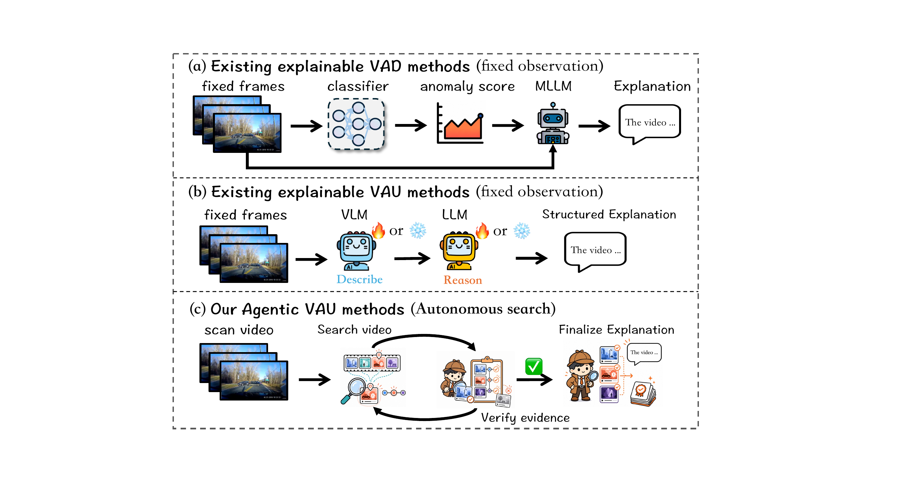
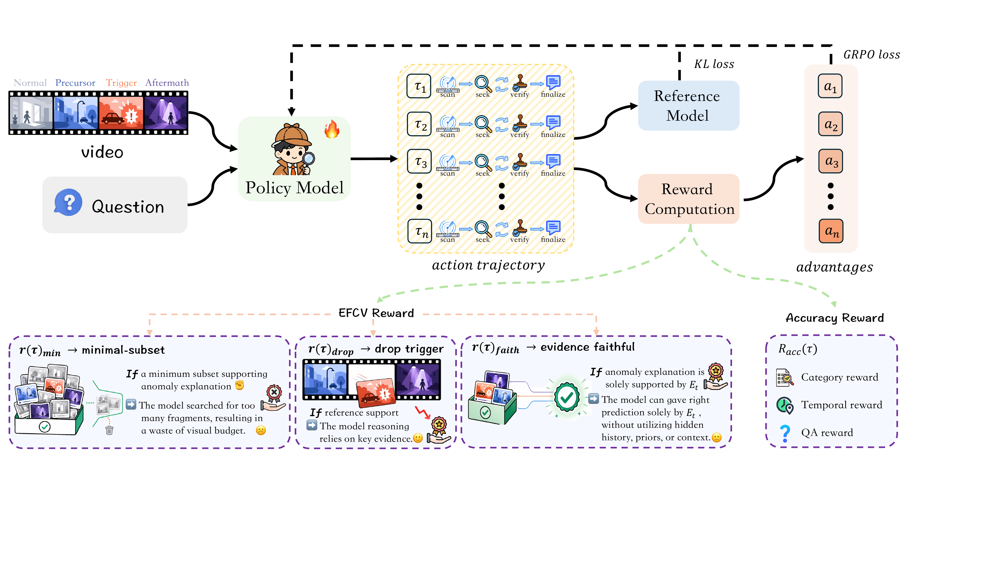
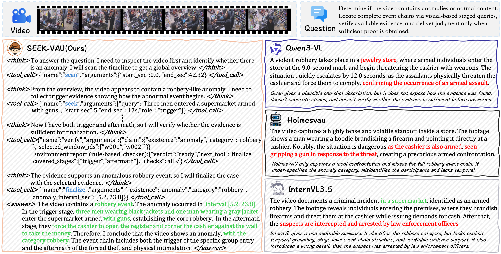

# SEEK-VAU: Towards Evidence-Faithful Video Anomaly Understanding via Agentic Search

<!-- TODO: replace arXiv placeholder links below with the real arXiv abs page -->
<!-- TODO: replace <HF_ACCOUNT>/SEEK-Bench with the real HuggingFace dataset link once created -->

[](https://arxiv.org/abs/XXXX.XXXXX)
[](https://neurips.cc/)
[](LICENSE)
[](#-seek-bench)
[](https://huggingface.co/datasets/<HF_ACCOUNT>/SEEK-Bench)

This is the official repository of the NeurIPS 2026 paper **"SEEK-VAU: Towards Evidence-Faithful Video Anomaly Understanding via Agentic Search"**, providing the full training / inference / evaluation code of SEEK-VAU and the **SEEK-Bench** benchmark.

**[[Paper]](https://arxiv.org/abs/XXXX.XXXXX)** · **[[SEEK-Bench Dataset]](https://huggingface.co/datasets/<HF_ACCOUNT>/SEEK-Bench)**

<p align="center">
  
</p>

## 📰 News

- **`2026/11/01`**: 🎉 SEEK-VAU is accepted to **NeurIPS 2026**. Code and SEEK-Bench are released.
- `2026/XX/XX`: arXiv preprint available (link TBD).

## ✨ Highlights

- **Agentic search-and-verify VAU.** SEEK-VAU reframes video anomaly understanding (VAU) as an interactive *search-and-verify* protocol: instead of passively reasoning over a fixed, pre-sampled observation bundle, the policy actively acquires evidence, verifies its sufficiency, and finalizes an anomaly case only after verification.
- **Four executable actions.** The policy interacts through `scan` / `seek` / `verify` / `finalize`, which separates temporal-context construction from evidential commitment and enforces *verify-before-finalize* — making event-chain completeness (precursor → trigger → aftermath) a recoverable behavioral target.
- **EFCV learning.** Evidence-Faithful Counterfactual Verification turns evidence faithfulness into RL training signal: the committed evidence must (i) support the anomaly claim, (ii) admit a compact sufficient subset, and (iii) lose support when the decisive trigger evidence is removed.
- **SEEK-Bench.** To our knowledge the first benchmark for interactive search-and-verify VAU, with temporal-interval, semantic QA, event-chain stage, and evidence-moment annotations for every episode.

## 🔭 Method

<p align="center">
  
</p>

SEEK-VAU instantiates the search-and-verify protocol as a tool-using policy built on [Qwen3-VL-8B](https://huggingface.co/Qwen/Qwen3-VL-8B-Instruct):

| Action | Role |
|---|---|
| `scan` | Explore a temporal window and write a coarse interval-level guide into the temporal search map. |
| `seek` | Turn the current temporal context into **committed evidence** via a stage-aware local query. |
| `verify` | Audit the evidence ledger for sufficiency / alignment / redundancy, and diagnose missing event-chain stages. |
| `finalize` | Close the case with a structured anomaly report only after the ledger passes verification. |

The policy is trained in two stages:

1. **SFT** on compact protocol traces that demonstrate the same `scan → seek → verify → finalize` interface used at inference;
2. **GRPO RL with EFCV**, where the rollout reward couples answer correctness ($R_{\mathrm{acc}}$) with counterfactual evidence-faithfulness rewards ($R_{\mathrm{efcv}} = r_{\mathrm{faith}} + r_{\mathrm{min}} + r_{\mathrm{drop}}$).

## 📊 SEEK-Bench

<p align="center">
  
</p>

SEEK-Bench is derived from [MSAD](https://arxiv.org/abs/2310.01307) and [ECVA](https://arxiv.org/abs/2412.07183), and re-annotated under a unified agentic VAU contract (model-assisted pre-annotation with Qwen3-VL-235B, followed by human review). Every episode contains anomaly labels, temporal intervals, semantic QA, event-chain stages, and evidence moments.

| Split | Episodes | Visual budget |
|---|---:|---|
| Train | 1,980 | ≤ 18 frames / episode |
| Test | 980 | ≤ 18 frames / episode |

**Metrics.** SEEK-Bench links temporal grounding, semantic correctness, and evidence recovery to a single benchmark contract:

- **Temporal mIoU** — anomaly interval grounding quality;
- **QA Accuracy** — semantic case understanding (semantic-equivalence judged);
- **Evidence F1@3** — top-3 evidence-window recovery against annotated evidence moments under a temporal-IoU criterion.

**Download** (annotations + splits):

```bash
# TODO: replace with the real dataset id once the HF repo is populated
git lfs install
git clone https://huggingface.co/datasets/<HF_ACCOUNT>/SEEK-Bench
```

Expected directory structure after preparing videos and annotations:

```
data/
├── videos/                  # source videos (MSAD / ECVA), organized by source dataset
└── seek_bench/
    ├── seek_bench_train.jsonl   # train episodes
    ├── seek_bench_test.jsonl    # test episodes
    └── evidence/                # evidence-moment annotations
```

> **License.** SEEK-Bench annotations are released under **CC BY-NC 4.0** (non-commercial). The source videos follow the terms of the original MSAD / ECVA datasets.

## 🔨 Installation

```bash
git clone https://github.com/cornell-hust/SEEK-VAU.git
cd SEEK-VAU

# Training environment (SFT + GRPO)
conda env create -f envs/train-qwen3-vl-8b-full.yml
conda activate idea2-v3-train

# Or inference / evaluation environment only (vLLM)
conda env create -f envs/infer-vllm.yml
conda activate idea2-v3-infer

# Package install
pip install -e ".[train]"
```

**Hardware.** Training was run on **8× H200 GPUs** (DeepSpeed ZeRO-3, bf16; FlashAttention-3 → Hopper-class GPUs required). Inference and evaluation run on a single H200/A100-class GPU via vLLM.

## 🚀 Quick Start (Inference)

```bash
# Base policy (for zero-shot / baseline runs)
export MODEL_PATH=Qwen/Qwen3-VL-8B-Instruct

# Run the SEEK-VAU search-and-verify policy with vLLM
bash scripts/run_policy_inference_vllm.sh
```

Each episode produces a structured rollout trace (`scan` / `seek` / `verify` / `finalize` actions, the committed evidence set, and the final anomaly case: existence, category, grounded interval, evidence, and explanation).

## 🏋️ Training

```bash
# Stage 1: SFT on protocol traces
bash scripts/train_sft_qwen3_vl_8b_ds8.sh

# Stage 2: GRPO RL with EFCV rewards
bash scripts/train_rl_qwen3_vl_8b_ds8.sh

# Or the one-shot pipeline (cache validation -> SFT -> rollout eval -> RL -> final eval)
EXP_NAME=exp8 bash scripts/run_full_pipeline.sh
```

<details><summary><b>Key hyperparameters</b> (paper configuration)</summary>

| Item | Value |
|---|---|
| Policy / base model | Qwen3-VL-8B-Instruct |
| Teacher judge (SFT trace preparation) | Qwen3-VL-32B-Instruct |
| RL algorithm | GRPO |
| KL coefficient | 0.1 |
| Reward weights $w_{\mathrm{acc}}$ / $w_{\mathrm{efcv}}$ | 0.5 / 0.5 |
| EFCV: sufficiency threshold $\theta$, redundancy budget $B_{\mathrm{red}}$ | 0.5, 2 |
| Episode budget | ≤ 8 turns; 1 `scan` (6 frames) + 3 `seek`–`verify` loops (4 frames each) + 1 `finalize` |
| Visual frames | ≤ 18 sampled / episode; ≤ 16 visible at any decision step |
| Precision / sharding | bf16 / DeepSpeed ZeRO-3 |
| Hardware | 8× H200 |

</details>

## 📈 Evaluation

```bash
# Evaluate a trained SEEK-VAU checkpoint on SEEK-Bench
bash scripts/run_policy_rollout_vllm.sh

# Fixed-observation baseline under the matched 18-frame budget
bash scripts/run_fixed_baseline_eval_vllm.sh
```

Evaluation reports **Temporal mIoU**, **QA Accuracy**, and **Evidence F1@3** on the SEEK-Bench test split (980 episodes).

## 🏆 Main Results

All compared methods are evaluated on SEEK-Bench under a matched visual budget; fine-tuned methods share the same training episodes (see paper §4 for details).

| Method | Base Model | Temporal mIoU | QA Accuracy |
|---|---|---:|---:|
| *Video MLLMs* | | | |
| GLM-4.1V | GLM-4.1V-8B | 4.6 | 16.4 |
| Kimi-VL | Kimi-VL-A3B | 7.3 | 16.3 |
| InternVL3.5 | InternVL3.5-8B | 25.5 | 19.4 |
| Qwen3-VL | Qwen3-VL-8B | 44.2 | 37.7 |
| *Video Reasoning MLLMs* | | | |
| Video-R1 | Qwen2.5-VL-7B | 9.8 | 8.4 |
| VideoChat-R1 | Qwen2.5-VL-7B | 10.0 | 13.3 |
| MiMo-VL | MiMo-VL-8B | 39.4 | 16.5 |
| Ovis2.5 | Qwen3-8B | 41.8 | 24.7 |
| *MLLM-based VAU Methods* | | | |
| HAWK | LLaMA-2 7B | 3.7 | 19.2 |
| Holmes-VAU | InternVL2-2B | 7.4 | 20.7 |
| VERA | InternVL2-8B | 31.5 | 18.6 |
| **SEEK-VAU (ours)** | **Qwen3-VL-8B** | **55.6** | **45.5** |

On **Evidence F1@3**, SEEK-VAU reaches **43.7**, ahead of the strongest baselines Qwen3-VL (28.1) and MiMo-VL (27.6) — the search-and-verify protocol improves not only final answers but also the recovery of the evidence windows that justify them, while using *fewer* frames on average than the fixed budget.

<details><summary><b>Ablation study</b> (attribution of gains)</summary>

| Method | T. mIoU | QA Acc. | E. F1 |
|---|---:|---:|---:|
| Fixed obs. + basic sup. | 44.2 | 37.7 | 28.1 |
| Fixed obs. + rich sup. | 46.9 | 38.2 | 28.3 |
| Active + basic sup. | 50.1 | 40.1 | 34.3 |
| Active + rich sup. (w/o EFCV) | 54.4 | 42.7 | 41.6 |
| **SEEK-VAU (full)** | **55.6** | **45.5** | **43.7** |

</details>

## 👀 Case Study

<p align="center">
  
</p>

In this jewelry-store robbery case, SEEK-VAU first scans the surveillance timeline to form a global hypothesis, then seeks trigger evidence (thieves entering the store, breaking the front glass, stealing jewelry), verifies that the selected support covers the required event stages, and only then finalizes the robbery category with the localized interval.

## 🗂️ Repository Structure

```
SEEK-VAU/
├── saver_v3/            # core package
│   ├── core/            #   actions, tools, rollout, verification, event chain, EFCV rewards
│   ├── model/           #   Qwen3-VL loading and vLLM generation
│   ├── data/            #   datasets, protocol traces, prepared SFT data
│   ├── sft/             #   Stage-1 supervised fine-tuning
│   ├── rl/              #   Stage-2 GRPO RL with EFCV
│   ├── metrics/         #   Temporal mIoU / QA Accuracy / Evidence F1 evaluators
│   ├── inference/       #   vLLM rollout, message runtime, predictor
│   ├── teacher/         #   teacher judge for trajectory preparation
│   ├── common/          #   experiment logging, runtime, message budget
│   └── cli/             #   train / eval command-line entry points
├── envs/                # conda environments (train / inference)
├── scripts/             # one-click training / evaluation / inference scripts
├── configs/             # experiment configs
└── docs/                # additional documentation
```

## ✏️ Citation

If you find SEEK-VAU or SEEK-Bench useful for your research, please cite:

```bibtex
@inproceedings{seekvau2026,
  title     = {SEEK-VAU: Towards Evidence-Faithful Video Anomaly Understanding via Agentic Search},
  author    = {TODO: full author list from the camera-ready paper},
  booktitle = {Advances in Neural Information Processing Systems (NeurIPS)},
  year      = {2026}
}
```

## 👍 Acknowledgements

- SEEK-Bench is derived from and inspired by [MSAD](https://arxiv.org/abs/2310.01307) and [ECVA](https://arxiv.org/abs/2412.07183).
- SEEK-VAU builds on [Qwen3-VL](https://github.com/QwenLM/Qwen3-VL), [vLLM](https://github.com/vllm-project/vllm), [DeepSpeed](https://github.com/microsoft/DeepSpeed), and [Transformers](https://github.com/huggingface/transformers). The GRPO implementation follows [DeepSeekMath](https://arxiv.org/abs/2402.03300).
- We thank the open-source community for these excellent projects.

## 📄 License

- **Code** in this repository is released under the **Apache 2.0 License** (see [LICENSE](LICENSE)).
- **SEEK-Bench annotations** are released under **CC BY-NC 4.0** (non-commercial use only). Source videos remain under their original MSAD / ECVA terms.

## 📮 Contact

For questions and bug reports, please open an issue on [GitHub Issues](https://github.com/cornell-hust/SEEK-VAU/issues). We aim to respond within a few days.
